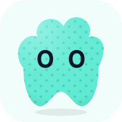

  <table border="0" align="center">
    <tr>
      <td align="center">
        
      </td>
      <td align="center">
        
      </td>
      <td align="center">
        
      </td>
    </tr>
  </table>

  # Christopher Gómez Andrade
  **Full-Stack Software Engineer | Enterprise Platforms & Interactive Systems**

  

    
    
    
    
    
  

---

## 📌 Perfil Profesional

Ingeniero de software **Full-Stack** con sólida experiencia en el diseño, desarrollo e implementación de plataformas empresariales de misión crítica, aplicaciones web de alta concurrencia y sistemas gráficos interactivos.

- **Plataformas de Gestión Escolar y Sistemas Educativos:** Arquitectura y desarrollo de soluciones integrales para instituciones académicas (control escolar, expedientes de alumnos, evaluación docente, facturación/cobranza y portal de autoservicio para la comunidad escolar).
- **Sistemas de Gestión de Personal y Control Operativo (HR / Workforce Management):** Implementación de plataformas para seguimiento operativo, control de incidencias, turnos, asistencia y emisión de reportería gerencial.
- **Sistemas CRM para Nichos Especializados:** Desarrollo de software a medida para prospección, gestión de catálogo de activos, embudos de venta y automatización de procesos comerciales (e.g., sector inmobiliario y de servicios).
- **Computación Gráfica y Motores Procedurales:** Especialista en dinámicas vectoriales en tiempo real (SVG/Canvas), transformaciones matemáticas de curvas de Bézier, físicas elásticas y micro-interacciones de alto rendimiento.

---

## 🌟 Proyecto Estrella: Moldy

### **Playground Interactivo de Mascotas 2D & Motor Procedural SVG**

> **[Moldy](https://moldy-xi.vercel.app/)** es un motor procedural y playground interactivo que genera mascotas vectoriales en tiempo real mediante algoritmos matemáticos en curvas SVG, 16 estados cinemáticos reactivos y físicas elásticas de compresión.

  

 

  
  
  

 

#### Arquitectura y Capacidades de Moldy:
- **Motor Procedural Libre de Imágenes Rasterizadas:** Cálculo dinámico de trazados orgánicos con curvas de Bézier cúbicas, máscaras SVG, gradientes volumétricos y patrones de textura generados al vuelo.
- **Máquina de Estados Cinemática (16 Actitudes):** Transición fluida entre actitudes emocionales (*Neutral, Attentive, Excited, Happy, Angry, Curious, Shy, Sleepy*, etc.) que alteran postura, escala y expresión.
- **Seguimiento Reactivo y Físicas *Squish*:** Detección de puntero para seguimiento de mirada en tiempo real y dinámica de deformación elástica por toque (*boop/squish*), con ciclo de respiración y parpadeo orgánico.
- **Modelo de Distribución y Licenciamiento:** El núcleo generador y código fuente de la aplicación se mantienen bajo **licencia privada**, mientras que las mascotas exportadas (`.SVG` y `.PNG`) se ofrecen para uso libre tanto personal como comercial bajo licencia **[Creative Commons Atribución 4.0 (CC BY 4.0)](https://github.com/Gomand06/Moldy)**. El repositorio público funciona como vitrina técnica (Showcase), documentación y especificación de uso.

---

## 💼 Plataformas y Proyectos Seleccionados

| Plataforma / Proyecto | Tipo / Dominio | Descripción Técnica y Alcance | Stack Principal |
| :--- | :--- | :--- | :--- |
| **[Moldy](https://moldy-xi.vercel.app/)** | Motor Gráfico / Web App | Motor procedural y playground de generación de avatares SVG con cinemática reactiva y física elástica. | `React 19` `TypeScript` `Tailwind CSS` `Vite` `SVG API` |
| **Plataforma Integral de Gestión Escolar** | Sistema Educativo / ERP Escolar | Plataforma completa para instituciones educativas: control escolar, administración de calificaciones, portal de docentes, expedientes y gestión financiera/cobranza. | `Full-Stack Web` `Bases de Datos` `Servicios Cloud` `RBAC` |
| **Sistema de Gestión de Personal (CoreControl)** | Operaciones & HR Management | Plataforma integral para supervisión operativa, registro y control de asistencia de personal, gestión de incidencias, turnos y reportería automatizada. | `Arquitectura Modular` `Dashboard Analytics` `REST APIs` |
| **CRM Inmobiliario Especializado** | CRM Vertical / Bienes Raíces | Plataforma CRM orientada al sector inmobiliario: gestión integral de catálogo de inmuebles, prospección de clientes, embudos de venta y seguimiento comercial. | `JavaScript` `Cloud Storage` `Filtros Avanzados` `Web UI` |
| **[HackathonTecMty2025](https://github.com/Gomand06/HackathonTecMty2025)** | Prototipado de Alto Rendimiento | Solución tecnológica desarrollada en formato intensivo y entorno colaborativo ágil para el Hackathon del Tecnológico de Monterrey. | `JavaScript` `HTML5` `CSS3` `Web APIs` |

---

## 🛠️ Stack Tecnológico y Habilidades

### Lenguajes y Fundamentos

  
  
  
  
  

### Frontend, UI/UX & Sistemas Interactivos

  
  
  
  
  
  

### Backend, Bases de Datos & Infraestructura Cloud

  
  
  
  
  
  

---

## 📊 Métricas de Desarrollo en GitHub

  <table border="0">
    <tr>
      <td align="center">
        
      </td>
      <td align="center">
        
      </td>
    </tr>
  </table>

   

  

    

  

---

## ☕ Apoyo al Desarrollo de Proyectos

Si encuentras valor en mis desarrollos, utilizas herramientas como **Moldy** en tus proyectos o deseas respaldar mi trabajo continuo en software y plataformas de código libre:

  

---

## 💼 Contacto y Enlaces Profesionales

  
  
  
  

---

  Christopher Gómez Andrade • Software Engineering Portfolio

